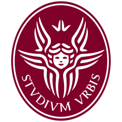

  

  

 

## 🔹 Contacts
&nbsp;&nbsp;&nbsp;&nbsp;

&nbsp;&nbsp;

 

## 🔹 About
&nbsp;&nbsp;&nbsp;&nbsp;
📍 **Position**&nbsp;&nbsp;&nbsp;&nbsp;Rome / Salerno, Italy &nbsp;&nbsp;&nbsp;&nbsp; 🇮🇹 `UTC +1`

 

## 🔹 Education
&nbsp;&nbsp;&nbsp;&nbsp; 
 &nbsp; **Sapienza Università di Roma**  
  
&nbsp;&nbsp;&nbsp;&nbsp;&nbsp;&nbsp;&nbsp;&nbsp;&nbsp;&nbsp;&nbsp; **Msc** in Genetics and Molecular Biology  
&nbsp;&nbsp;&nbsp;&nbsp;&nbsp;&nbsp;&nbsp;&nbsp;&nbsp;&nbsp;&nbsp; 🔹 **Final grade** &nbsp;&nbsp;&nbsp;&nbsp;&nbsp;&nbsp;&nbsp;&nbsp;&nbsp;&nbsp;&nbsp;&nbsp;&nbsp;&nbsp;&nbsp;&nbsp;&nbsp;&nbsp;&nbsp;&nbsp;&nbsp; 110 / 110 _cum Laude_  
&nbsp;&nbsp;&nbsp;&nbsp;&nbsp;&nbsp;&nbsp;&nbsp;&nbsp;&nbsp;&nbsp; 🔹 **Grade point average** &nbsp;&nbsp;&nbsp;&nbsp;&nbsp;&nbsp; 30+ / 30  

 

&nbsp;&nbsp;&nbsp;&nbsp; 
 &nbsp; **UNISA Università degli Studi di Salerno**  
 
&nbsp;&nbsp;&nbsp;&nbsp;&nbsp;&nbsp;&nbsp;&nbsp;&nbsp;&nbsp;&nbsp; **Bsc** in Biological Sciences  
&nbsp;&nbsp;&nbsp;&nbsp;&nbsp;&nbsp;&nbsp;&nbsp;&nbsp;&nbsp;&nbsp; 🔹 **Final grade** &nbsp;&nbsp;&nbsp;&nbsp;&nbsp;&nbsp;&nbsp;&nbsp;&nbsp;&nbsp;&nbsp;&nbsp;&nbsp;&nbsp;&nbsp;&nbsp;&nbsp;&nbsp;&nbsp;&nbsp;&nbsp; 110 / 110 _cum Laude_  
&nbsp;&nbsp;&nbsp;&nbsp;&nbsp;&nbsp;&nbsp;&nbsp;&nbsp;&nbsp;&nbsp; 🔹 **Grade point average** &nbsp;&nbsp;&nbsp;&nbsp;&nbsp;&nbsp; 28.5 / 30

 

## 🔹 Languages
&nbsp;&nbsp;&nbsp;&nbsp;  &nbsp; **Italian** &nbsp;&nbsp;&nbsp;&nbsp;&nbsp;&nbsp;&nbsp;&nbsp;&nbsp;&nbsp;&nbsp;&nbsp;&nbsp;&nbsp;&nbsp;&nbsp;&ensp; `Native`  
&nbsp;&nbsp;&nbsp;&nbsp;  &nbsp; **English** &nbsp;&nbsp;&nbsp;&nbsp;&nbsp;&nbsp;&nbsp;&nbsp;&nbsp;&nbsp;&nbsp;&nbsp;&nbsp;&emsp; `B2`  
&nbsp;&nbsp;&nbsp;&nbsp;  &nbsp; **Esperanto** &nbsp;&nbsp;&nbsp;&nbsp;&nbsp;&nbsp;&nbsp;&nbsp;&emsp; `B2`  
