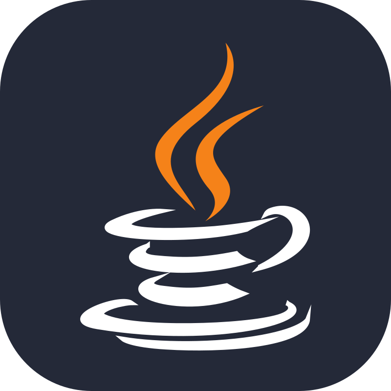
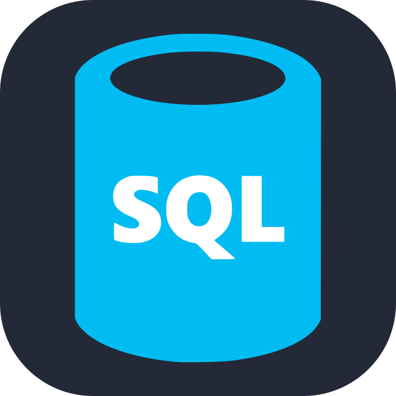
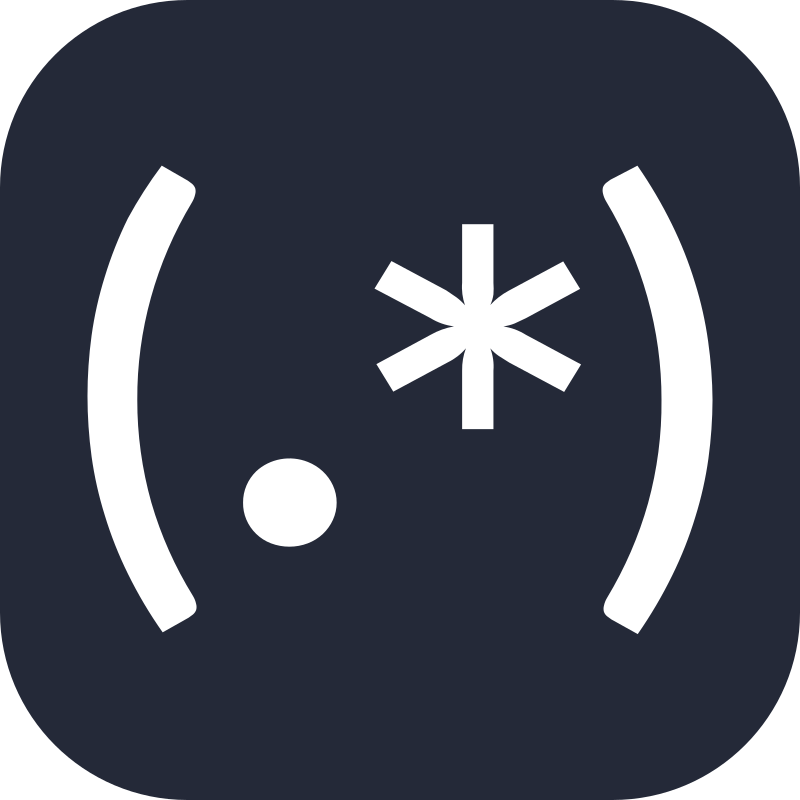
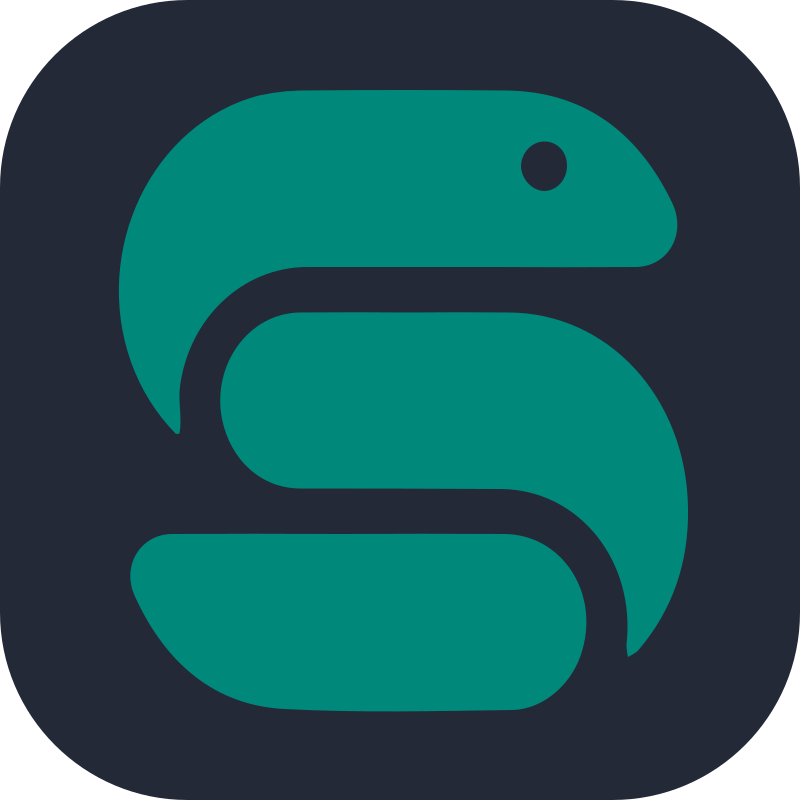
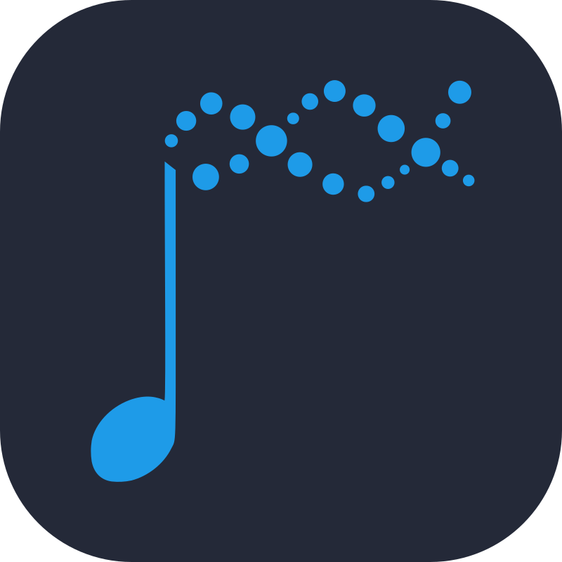
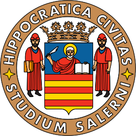
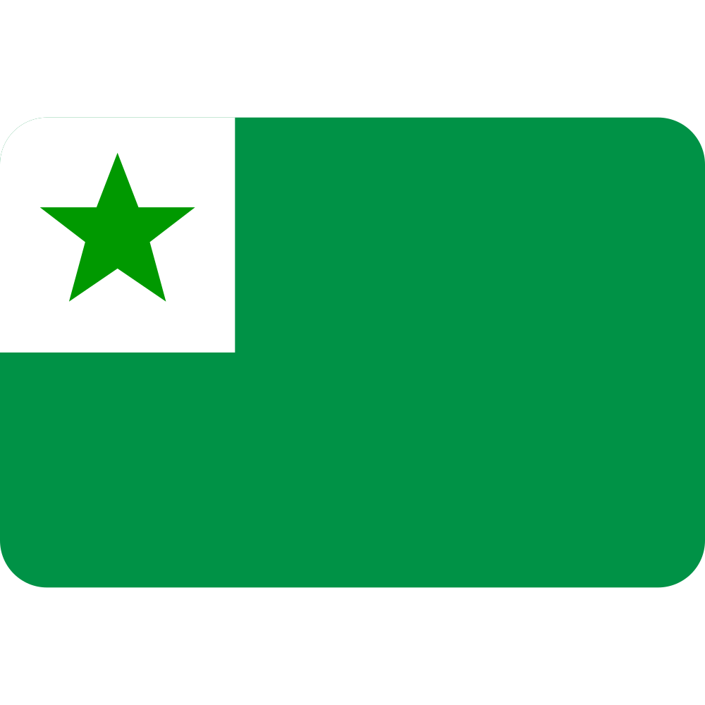

  

  

 

## 🔹 Contacts
&emsp; 
&ensp; 

 

## 🔹 About
&emsp; _[TODO]_: fare bottom, about, 2 programmi, convertire contacts

📍 **Position**&nbsp;&nbsp;&nbsp;&nbsp;Rome / Salerno, Italy &nbsp;&nbsp;&nbsp;&nbsp; 🇮🇹 `UTC +1`

 

## 🔹 Stack
### &emsp; 🔹 **Operating Systems**

  &emsp;&emsp;&emsp;
     &nbsp;
    

### &emsp; 🔹 **Programming Languages**

  &emsp;&emsp;&emsp;
     &nbsp;
     &nbsp;
    
  &emsp;&emsp;
     &nbsp;
     &nbsp;
    

  &emsp;&emsp;&emsp;
     &nbsp;
     &nbsp;
    
  &emsp;&emsp;
     &nbsp;
     &nbsp;
    

### &emsp; 🔹 **Software**

  &emsp;&emsp;&emsp;
     &nbsp;
     &nbsp;
     &nbsp;
    
  &emsp;&emsp;
     &nbsp;
    
  
  &emsp;&emsp;&emsp;
     &nbsp;
     &nbsp;
     &nbsp;
    
  &emsp;&emsp;
     &nbsp;
    

### &emsp; 🔹 **Frameworks & Libraries**

  &emsp;&emsp;&emsp;
     &nbsp;
     &nbsp;
     &nbsp;
     &nbsp;
     &nbsp;
    

 

## 🔹 Education
&emsp;  &nbsp; **Sapienza Università di Roma**  
  
&emsp;&emsp;&emsp;  **Msc** in Genetics and Molecular Biology  
&emsp;&emsp;&emsp; 🔹 **Thesis subject**      &emsp;&emsp;&emsp;&emsp;&emsp;       _Bioinformatics_  
&emsp;&emsp;&emsp; 🔹 **Final grade**         &emsp;&emsp;&emsp;&emsp;&emsp;&emsp; 110 / 110 _cum Laude_  
&emsp;&emsp;&emsp; 🔹 **Grade point average** &emsp;&emsp;                         30+ / 30  

 

&emsp;  &nbsp; **UNISA Università degli Studi di Salerno**  
  
&emsp;&emsp;&emsp; **Bsc** in Biological Sciences  
&emsp;&emsp;&emsp; 🔹 **Thesis subject**      &emsp;&emsp;&emsp;&emsp;&emsp;       _Molecular Docking_  
&emsp;&emsp;&emsp; 🔹 **Final grade**         &emsp;&emsp;&emsp;&emsp;&emsp;&emsp; 110 / 110 _cum Laude_  
&emsp;&emsp;&emsp; 🔹 **Grade point average** &emsp;&emsp;                         28.5 / 30

 

## 🔹 Languages
  &emsp;  &nbsp; **Italian**   &emsp;&emsp;&emsp;&emsp;&emsp; `Native`
  &emsp;&emsp;&emsp;&emsp;&emsp;
  &emsp;  &nbsp; **English**   &emsp;&emsp;&emsp;&emsp;&ensp; `B2`  
  &emsp;  &nbsp; **Esperanto** &emsp;&emsp;&emsp;&nbsp;       `B2`
